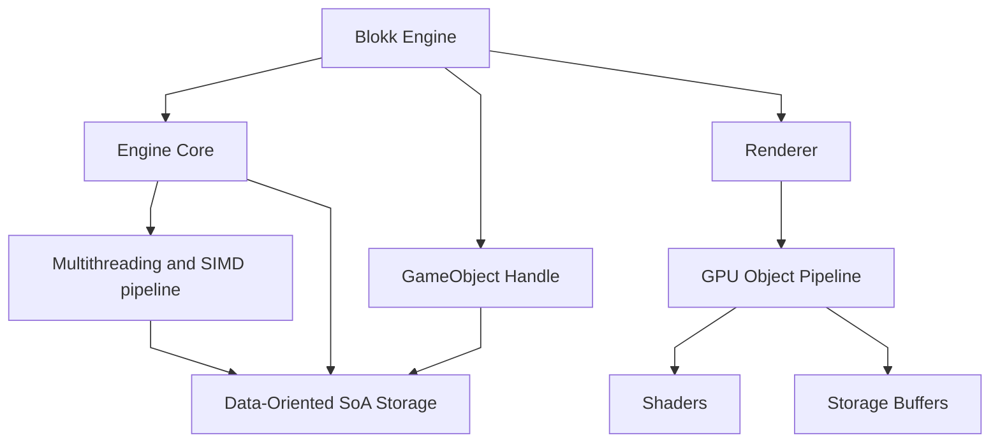

# The Background Engine Architecture

- [GPU Pipeline](#gpu-pipeline)
  - [Vulkan Backend](#vulkan-backend)
  - [GPU Parallelism](#gpu-parallelism)
  - [Limitations](#limitations)
  - [Shaders](#shaders)
- [CPU Pipeline](#cpu-pipeline)
  - [Parallelism](#parallelism)
    - [Adaptive Timing](#adaptive-timing)
    - [Fixed Thread Count](#fixed-thread-count)
  - [CPU Object Update Functions](#cpu-object-update-functions)
  - [SIMD](#simd)
    - [SIMD Fallback](#simd-fallback)
- [Data Layout](#data-layout)
  - [Dynamic and Static Objects](#dynamic-and-static-objects)
- [Animation Data](#animation-data)
- [Overall Architecture](#overall-architecture)

The Blokk engine is the part of the engine responsible for managing and processing `GameObject` data every frame.

It is designed to process large numbers of objects efficiently by combining:

* Parallel processing
* SIMD optimizations
* Cache-friendly data layouts
* Configurable engine systems

The currently implemented systems include:

* Movement with Velocity
* Animations
* Visibility
* Rendering
* Culling

Visibility and culling systems can be configured depending on the needs of the application.

---

# GPU Pipeline

The GPU pipeline is faster than the CPU pipeline. It has the capability to handle massive batches of objects but has important limitations.

## Vulkan Backend

The engine uses Vulkan as the backend library with some helper libraries:
* **vk-bootstrap**: Reduces thousands of lines of initialization code to ~40
* **VMA**: Handles memory management 
* **volk**: Dynamically loads Vulkan function pointers directly from the GPU driver, bypassing loader overhead

The engine uses **HLSL** (High Level Shader Language) for the shaders. 

---

## GPU Parallelism 

The engine uses parallelism while using compute shaders. **It is hardcoded to 256 threads for the `numthreads` and dispatches according to the number of objects it needs to update. 

Compute shaders use a hardcoded workgroup size of `[numthreads(256, 1, 1)]` and dispatch `ceil(objectCount / 256)` thread groups. This meets standard Vulkan hardware limits and works across virtually all modern GPUs.

## Limitations 

The GPU pipeline, because it is updated by compute shaders, has limitations. 

### 1) Objects can't be updated

Other than giving the engine large batches of data and deleting objects, the objects submitted to the GPU can't be accessed by the engine. This means that, once you submit objects, you can't retrieve their data later.

The only thing you can do is add large batches and delete objects scattered everywhere.

### 2) Data transfer is slow

The GPU pipeline is designed to allow the user to submit large batches of objects and efficiently handle those large batches. **It was not designed to handle hundreds of indivudal batches**, which will tank your frame rate.

The reason it can't it because it has to update states, run shaders, submit data to GPU memory, etc. These processes are not too bad if used once but will be very costly to performance if done too many times.

This is why it's much, much better to submit a large batch of data at once instead of individual batches for performance and also because the engine was designed that way.

### 3) Objects are simple

Because the objects are updated by the GPU, objects:
* Can't run any functions **including update functions**
* Data can't be seen by the main CPU engine, so can't be updated by the user
* Engine can't take adaptive measures to better handle the load of objects, even though the GPU pipeline is much faster in theory

---

## Shaders

The engine uses compute shaders under the hood to process data in parallel. There are multiple shaders, each with a unique job. For example, one shader handles velocities and incrementing frame numbers, while other shaders handle culling objects.

The engine tries to keep the shader count low, because invoking a shader can have a cost. This is why a shader can have multiple jobs. 

Shaders all have safety mechanisms to prevent memory issues. Shaders are also optimized for efficient memory usage and also simplicity. 

The engine, instead of loading .spv files at runtime, converts the .hlsl files into c-style `const char*` arrays at compile time. The rendering engine that handles the compute shaders then includes these files. The reason the engine does this is because now, the engine can be a standalone executable file, and the user doesn't have to go into folders or deal with extra files. The engine executable would have ot be run form within the directory if it loaded .spv files at runtime, but now it's only one file and the user can just click on it or put it wherever they would like to use it!

# CPU Pipeline

## Parallelism

Blokk uses multiple worker threads to parallelize engine processing.

When the engine starts, it determines the available CPU resources and initializes its worker threads. These threads remain active throughout the lifetime of the engine rather than being repeatedly created and destroyed during individual frames.

This avoids the overhead associated with repeatedly creating and destroying operating-system threads.

---

### Adaptive Timing

At the beginning of each frame, the main thread determines how the current workload should be divided.

Object data is split into **non-overlapping ranges of indexes**, and each worker thread is assigned a range to process.

For example, with four worker threads and 1,000 objects, the workload could be divided as follows:

| Thread   | Assigned Range |
| -------- | -------------- |
| Thread 1 | 0 - 249        |
| Thread 2 | 250 - 499      |
| Thread 3 | 500 - 749      |
| Thread 4 | 750 - 999      |

Because each thread receives a unique range, multiple threads do not modify the same object data at the same time for systems using this processing model.

This reduces the need for synchronization and concurrent data structures within these operations.

The engine processes one system at a time. Once all worker threads have finished the current system, the engine moves on to the next system.

The order of systems is fixed because some systems depend on the results of earlier systems. For example, a system that uses object positions may depend on movement having already been processed.

The general process is:

```text
Start Frame
    ↓
Determine Workload Ranges
    ↓
Assign Ranges to Worker Threads
    ↓
Process System
    ↓
Wait for All Threads
    ↓
Process Next System
    ↓
Repeat
```

### Fixed Thread Count

Blokk also provides a fixed thread-count configuration.

With a fixed thread count, the user can control how many worker threads are used by the engine.

The worker threads are still created once and reused throughout the engine's lifetime. Changing to a fixed thread count does **not** require the engine to repeatedly create and destroy threads during frame processing.

The primary difference is that the engine does not dynamically determine the worker count for each workload.

> **Note:** Creating and destroying threads repeatedly can introduce significant overhead. Blokk therefore keeps its worker threads alive and reuses them.

---

## CPU Object Update Functions

CPU Objects have update functions, which are functions called by the engine every frame. The user can override these functions and the engine will call them every frame. These can contain complex logic, change the object's data or much more. You can even do calculations with them if you want!
The function signature is:
```cpp
void GameObject::_Update(double delta) {}
```

The engine first, inside the loading functions in parallel, times every GameObject update function and store it, and also stores the total amount of time for the frame. The engine basically just runs th egame and adapts to it first. 

If the total time is greater than the time it needs to take, the engine will stop calling certain functions with a lower priority until the time taken is enough to fit inside the time.

## SIMD

Blokk uses **SIMD (Single Instruction, Multiple Data)** to perform the same operation on multiple values simultaneously.

SIMD allows an engine system to process multiple pieces of object data within a single instruction when the operation and data layout allow it.

For example, a 128-bit register can contain four 32-bit floating-point values:

```text
128 bits
┌────────┬────────┬────────┬────────┐
│ float  │ float  │ float  │ float  │
│  32    │  32    │  32    │  32    │
└────────┴────────┴────────┴────────┘
```

Likewise:

| SIMD Instruction Set | Register Width | 32-bit Floats |
| -------------------- | -------------- | ------------- |
| SSE / SSE2           | 128-bit        | 4             |
| AVX / AVX2           | 256-bit        | 8             |
| AVX-512              | 512-bit        | 16            |
| NEON                 | 128-bit        | 4             |

The exact number of objects processed per SIMD operation depends on the implementation and the data being processed. These values represent the number of 32-bit floating-point values that can fit in a register, not necessarily the number of complete objects processed by every operation.

---

### SIMD Fallback

SIMD is an optimization rather than a requirement.

Blokk detects the available SIMD capabilities of the target architecture at runtime and selects an appropriate implementation. When compiling, the engine will also check if the compiler supports the SIMD type.

When a supported SIMD implementation is unavailable, Blokk can use a **scalar implementation** instead.

This allows the engine to remain functional on processors without the SIMD instruction set required by an optimized implementation.

The general model is:

```text
CPU
 │
 ├── Supported SIMD
 │      ├── SSE2
 │      ├── AVX2
 │      ├── AVX-512
 │      └── NEON
 │
 └── No applicable SIMD
          ↓
       Scalar
```

This architecture allows Blokk to prioritize portability without completely giving up hardware-specific optimizations.

---

# Data Layout

Blokk stores object data in **cache-friendly vectors** while exposing a `GameObject` class instance for each object.

This provides a convenient object-oriented interface to the user while allowing the engine's internal systems to use a data-oriented representation.

When a `GameObject` is created, its individual fields are stored in **Structure of Arrays (SoA)** form.

For example, positions are stored conceptually as:

```text
X Positions:
┌────┬────┬────┬────┬────┐
│ x0 │ x1 │ x2 │ x3 │ x4 │
└────┴────┴────┴────┴────┘

Y Positions:
┌────┬────┬────┬────┬────┐
│ y0 │ y1 │ y2 │ y3 │ y4 │
└────┴────┴────┴────┴────┘
```

Instead of storing each object's complete position together:

```text
┌────────┬────────┬────────┬────────┐
│ (x0,y0)│ (x1,y1)│ (x2,y2)│ (x3,y3)│
└────────┴────────┴────────┴────────┘
```

This layout provides better memory locality for systems that operate on a specific field across many objects.

It also makes the data easier to process using SIMD because consecutive values can be loaded into SIMD registers.

---

## Dynamic and Static Objects

Blokk separates dynamic and static object data within its internal storage.

Dynamic objects, which can change position through movement, are kept toward the beginning of the relevant data structures, while static objects are kept toward the end.

This allows systems that operate primarily on moving objects to process a contiguous region of data without unnecessarily processing static objects.

Static objects do not require velocity storage because their velocity is always `{0, 0}`.

A simplified representation is:

```text
Object Data

┌───────────────────────────────────────┐
│ Dynamic Objects                       │
│                                       │
│ Object 0                              │
│ Object 1                              │
│ Object 2                              │
│ ...                                   │
├───────────────────────────────────────┤
│ Static Objects                        │
│                                       │
│ Object N                              │
│ Object N+1                            │
│ ...                                   │
└───────────────────────────────────────┘
```

Blokk also maintains references to the corresponding `GameObject` instances so that the user-facing object interfaces remain associated with their underlying engine data when internal storage is rearranged.

---

# Animation Data

The object's animation data is loaded through the renderer and stored in GPU memory. Since all rendering is done in GPU memory, the engine doesn't need to store anything to it. Every object has an index to their current animation frame, and they render using `vkCmdDrawIndirect`.

Not storing the animation data in the CPU allows for less memory used and no redundant data accessed.

---

# Overall Architecture

The combination of **SoA data storage, persistent worker threads, workload-based parallelism, SIMD implementations, and scalar fallbacks** allows Blokk to process object data using both hardware parallelism and data-level parallelism.

Conceptually:




